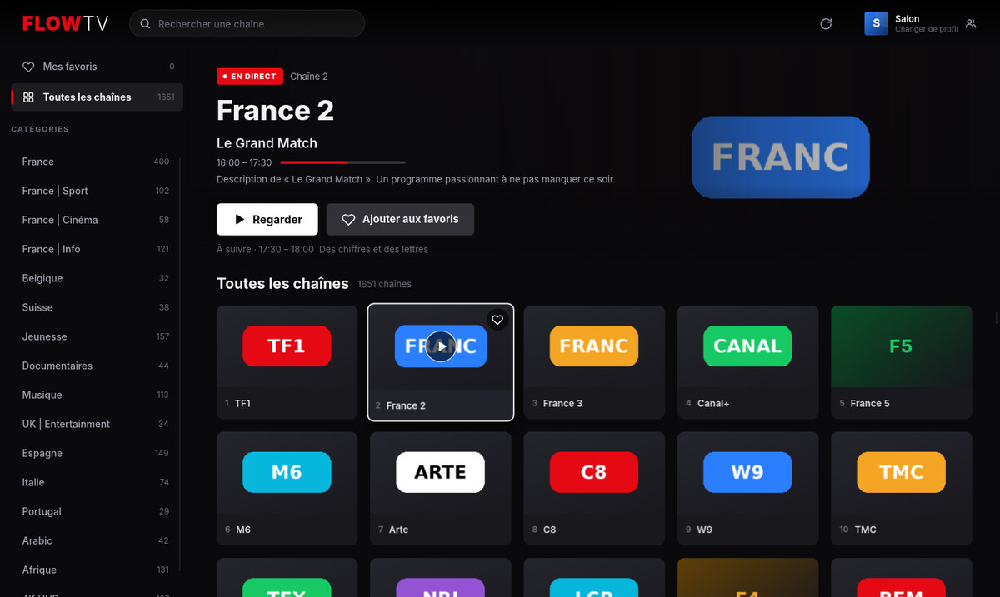
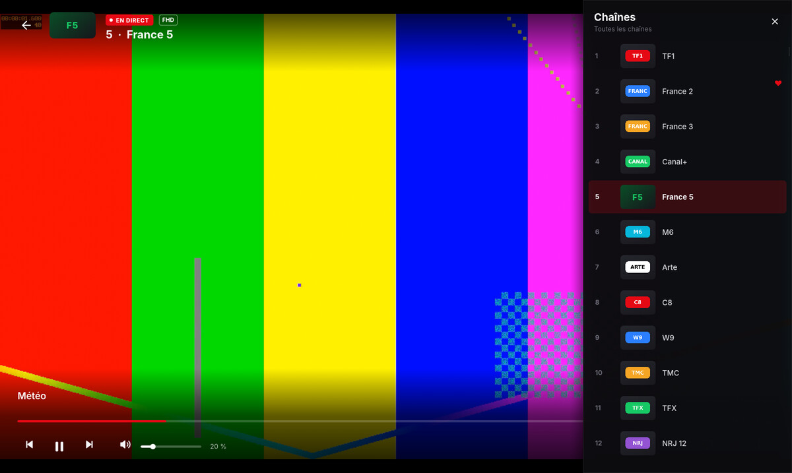

# Flow TV

Lecteur IPTV pour Windows, écrit en **Rust** avec **Slint** pour l'interface et **libmpv** pour la vidéo.
Il gère les chaînes **live** d'un compte **Xtream Codes**, avec plusieurs profils, des favoris, l'EPG
(programme en cours et à suivre) et un lecteur intégré directement dans la fenêtre.



| Profils | Lecteur intégré |
|---|---|
|  |  |

## Fonctionnalités

- **Profils façon Netflix** : chaque profil a son propre compte Xtream (serveur, identifiant, mot de passe),
  sa couleur, ses favoris et son cache. Les identifiants sont vérifiés auprès du serveur avant l'enregistrement.
- **Démarrage instantané** : le catalogue est mis en cache dans SQLite. Au lancement, il s'affiche tout de suite,
  et une synchronisation se fait en arrière-plan si le cache a plus de 12 h (ou avec le bouton ⟳).
- **Grandes listes fluides** : la grille et les listes sont virtualisées (seules les cartes visibles existent) et
  les logos se chargent à la demande, avec un cache disque et un cache mémoire.
- **Recherche instantanée** sur toutes les chaînes (insensible aux accents), catégories et favoris.
- **EPG** : programme en cours avec sa barre de progression, programme suivant, description.
- **Lecteur intégré (mpv)** : décodage matériel, tous les codecs (H.264/H.265, AC3/EAC3…), reconnexion
  automatique si le flux coupe, panneau de zapping, plein écran, contrôles qui se masquent automatiquement.

### Raccourcis du lecteur

| Touche | Action |
|---|---|
| `Espace` / `K` | Pause / lecture |
| `↑` / `↓` (ou `Page préc.` / `Page suiv.`) | Chaîne précédente / suivante |
| `←` / `→`, molette | Volume |
| `M` | Muet |
| `F`, `F11`, double-clic | Plein écran |
| `L` | Liste des chaînes |
| `Échap` | Fermer le panneau, quitter le plein écran, puis revenir à l'accueil |

## Prérequis (Windows)

1. **Rust** : installez [rustup](https://rustup.rs) et acceptez l'installation des *Visual Studio Build Tools*
   (charge de travail « Développement Desktop en C++ »).
2. **VS Code** avec les extensions **rust-analyzer** et **Slint** (aperçu en direct des fichiers `.slint`).
3. **libmpv** : lancez une fois, depuis la racine du projet :

   ```powershell
   powershell -ExecutionPolicy Bypass -File scripts\fetch-mpv.ps1
   ```

   Le script télécharge `libmpv-2.dll` (builds de *shinchiro/mpv-winbuild-cmake*) et la copie dans
   `vendor\mpv\`, `target\debug\` et `target\release\`. La DLL est chargée dynamiquement au démarrage :
   aucun fichier `.lib` n'est nécessaire à la compilation.

## Compiler et lancer

```powershell
cargo run              # version de développement (avec console et logs)
cargo build --release  # version optimisée : target\release\flow-tv.exe
```

La première compilation prend quelques minutes, les suivantes quelques secondes.

## Créer l'installateur (Inno Setup)

1. Installez [Inno Setup 6](https://jrsoftware.org/isdl.php).
2. Lancez :

   ```powershell
   powershell -ExecutionPolicy Bypass -File scripts\build-release.ps1
   ```

L'installateur `installer\Output\FlowTV-Setup-0.1.0.exe` contient `flow-tv.exe` et `libmpv-2.dll`.
Le runtime C est lié en statique (`.cargo/config.toml`) : aucun « Visual C++ Redistributable » n'est requis.

## Organisation du code

```
src/
  main.rs     démarrage, intégration du rendu vidéo dans la boucle Slint
  app.rs      contrôleur : profils, catalogue, filtres, EPG, favoris, lecture
  xtream.rs   client de l'API Xtream Codes (player_api.php)
  db.rs       stockage SQLite (profils, cache des chaînes, favoris, réglages)
  models.rs   catalogue en mémoire + modèles Slint virtualisés (grille, liste)
  logos.rs    téléchargement / cache / décodage des logos en arrière-plan
  mpv.rs      liaison dynamique avec libmpv
  player.rs   lecteur : rendu OpenGL de mpv sous l'interface, événements
ui/
  app.slint, state.slint, theme.slint, components.slint
  screens/    profiles.slint, home.slint, player.slint
installer/    script Inno Setup
scripts/      téléchargement de libmpv, build release
```

### Comment la vidéo est intégrée

Slint dessine avec OpenGL (moteur *femtovg*). À chaque image, Slint efface la fenêtre puis appelle le
callback `BeforeRendering` : mpv y dessine l'image vidéo (API `mpv_render_context`). Slint dessine ensuite
l'interface par-dessus (contrôles, EPG, liste des chaînes). La vidéo fait donc vraiment partie de la
fenêtre : les éléments se superposent et s'animent librement au-dessus, sans fenêtre native séparée.

## Données locales

- Base SQLite : `%APPDATA%\FlowTV\Flow TV\data\flowtv.db`
- Cache des logos : `%LOCALAPPDATA%\FlowTV\Flow TV\cache\logos\`

Les mots de passe Xtream sont stockés **en clair** dans la base locale (comme dans la plupart des lecteurs IPTV).
Une amélioration possible est de les chiffrer avec l'API Windows DPAPI.

## Licences

- **Slint** est utilisé sous sa licence *Royalty-free* (gratuite pour les applications desktop, y compris
  fermées). Elle impose de mentionner Slint : la mention « Réalisé avec Slint » de l'écran des profils
  remplit cette condition, gardez-la (ou affichez le badge *Made with Slint* sur votre site).
- **libmpv** : les builds courants sont sous **GPL**. Si vous distribuez l'application publiquement sans en
  publier le code, utilisez un build **LGPL** de libmpv et joignez sa licence (dossier `LICENSES\`, copié par
  l'installateur s'il existe).

## Tests

```powershell
cargo test
```

Les tests couvrent le stockage SQLite, le nettoyage des noms de chaînes (« FR: TF1 HD » → « TF1 HD »),
le décodage EPG et la normalisation des URL.
